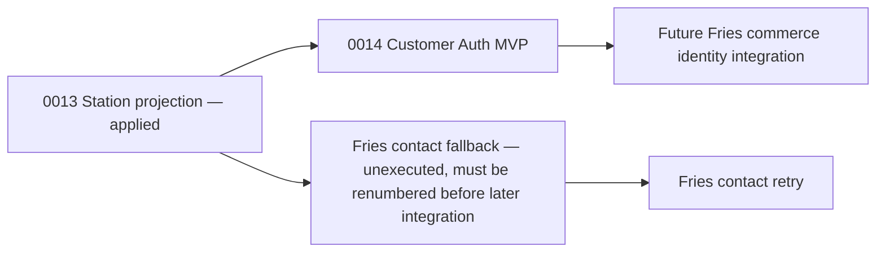

# SGL Customer Authentication MVP — Migration Dependency Audit

## Baseline

- Reproducible Production source baseline: `26837e5`.
- Production deployment observed during the audit: `dpl_AZKo2wje4EYmgydvT4HTTJrRMRSq`, created after `26837e5` and before later Station Intelligence commits.
- Confirmed Production migration registry supplied by the project owner: `0001`–`0013`.
- This development phase does not connect to or mutate Production PostgreSQL.

## Existing unexecuted migration files

| File | SHA-256 | Dependency | MVP requirement | Finding |
| --- | --- | --- | --- | --- |
| `0014_fries_contact_fallback.sql` | `3edf7fb24f29987a0ec6472fae2162cb630abc6193a61a14aa88327f57d4139d` | Support schema through `0013` | No | Creates Fries contact submissions only. |
| `0015_customer_membership_accounts.sql` | `6f50ec3d0a08e623ecc7aca6f76ad72b396d946a4bb265d9c1d009c4bc56c658` | Existing `customers` table | No, unsafe for this MVP | Creates broad addresses/wishlist/member schema and ties verification directly to a Customer ID. The corresponding old code issued a session before verification and could claim an existing Guest/CRM Customer by email. |
| `0016_fries_contact_retry.sql` | `ac04b446cc829fce4ffead991b412a9741d186bfbcf49b5b65c8d01bd6b9344a` | `0014_fries_contact_fallback.sql` | No | Adds retry metadata to Fries contact submissions. |
| `0017_fries_commerce_intelligence.sql` | `13e23478f8aac68597d089d250ef046ee753713505311649772fda9e0749e161` | Existing support schema and `customers`; Phase 6 code also expects customer authentication | No | Adds read-only Fries commerce activity. |

## Preview registry finding

The existing Vercel Preview Neon database is not a clean `0001`–`0013` target. A read-only registry query on 2026-11-13 returned `0001`–`0017`:

- `0014_fries_contact_fallback.sql` matches the reviewed checksum.
- `0015_customer_membership_accounts.sql` is recorded as `6f57c2630c1c58a8d731220b2b02b1eb41613ef14f746e6df4a0b0aae0933871`. Its exact source was recovered from Git blob `46aced1a3ca2746b41bdd317edc659b0b9ed09c7`; the difference from the visible working copy was its final newline.
- `0016_fries_contact_retry.sql` and `0017_fries_commerce_intelligence.sql` are recorded with `NULL` legacy checksums.
- The Preview schema contains the old customer credentials, sessions and verification tables, but no pending-registration table.

The existing Preview database was not reset. A separate compatibility branch, `preview/customer-auth-mvp-compat`, restored the exact historical sources, adopted only the reviewed `NULL` checksums for `0016` and `0017`, and applied forward-only `0018_customer_auth_claim_hardening.sql`. The clean Production candidate branch does not contain or execute those unrelated Fries migrations; it retains only the minimal `0014_customer_auth_mvp.sql` for a confirmed `0001`–`0013` Production registry.

## MVP migration

The isolated branch introduces `0014_customer_auth_mvp.sql` because the active Production registry ends at `0013` and the MVP release must remain contiguous under the existing migration runner.

The pending Fries migrations are not part of this branch or release. Because they are unexecuted, a future integration must allocate new forward-only sequence numbers and preserve their recorded SQL/checksums. No applied migration is renamed or edited.

## P0 ownership boundary

`0014_customer_auth_mvp.sql` stores an unverified registration in `customer_pending_registrations`, which has no `customer_id` foreign key. Verification locks the pending record and normalized email, validates a single-use token, then creates or links the Customer and credential in one transaction. Sessions require a verified credential and are never created during registration.

## Production release prerequisites

1. Verify Production registry is still exactly `0001`–`0013`, including checksums.
2. Create and restore-test an encrypted Production backup.
3. Confirm no table from an unexecuted `0014`/`0015` experiment exists outside the registry.
4. Apply only `0014_customer_auth_mvp.sql` through the guarded migration runner.
5. Configure server-only `CUSTOMER_AUTH_SECRET`, `CUSTOMER_EMAIL_DELIVERY_URL`, and `CUSTOMER_EMAIL_DELIVERY_TOKEN`.
6. Deploy the reviewed application commit, then test with an approved Preview account before any Production registration.
7. Roll back the application deployment first if acceptance fails. Database rollback is forward-only: disable registration, retain account records, and apply a separately reviewed corrective migration rather than dropping customer data.
